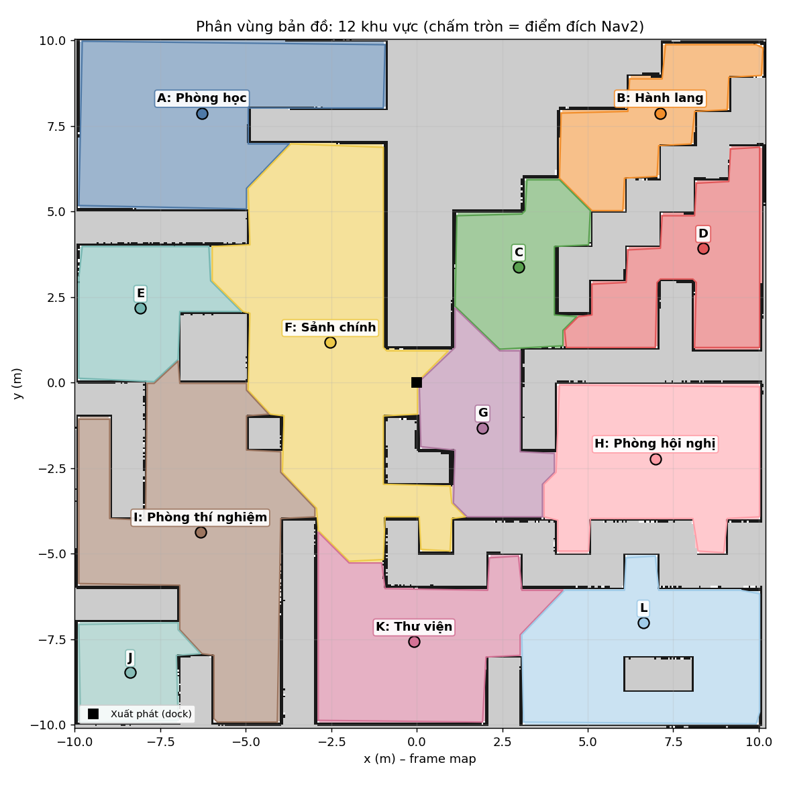

# TurtleBot 4 – Phân vùng bản đồ và điều hướng bằng giọng nói (Bài 7)

ROS 2 Humble · Ignition Gazebo Fortress · TurtleBot 4 Simulator · Nav2 · OpenCV · Vosk / Whisper

Micro → **`speech_recognizer_node`** (Vosk hoặc Whisper, tiếng Việt) → `/voice/text` →
**`voice_navigator`** (phân tích câu lệnh → tra khu vực trên bản đồ đã phân vùng → lộ trình) →
action `NavigateToPose` của **Nav2** → TurtleBot 4 tự đi tới khu vực, tránh vật cản.



| Yêu cầu của đề | Làm thế nào | Bằng chứng |
|---|---|---|
| Phân vùng bản đồ `.pgm` thành phòng / hành lang | `ros2 run tb4_lab04 zone_segmentation.py` – distance transform + watershed theo độ bền (OpenCV), có chế độ vẽ tay | `maps/map_zones.png` (12 khu vực), `maps/zones_labels.pgm` |
| Gắn nhãn A, B, C … + tên có nghĩa, toạ độ đích hợp lệ | `config/zone_names.yaml` (điểm neo → tên); điểm đích tự chọn: trống, cách tường ≥ 0,5 m, robot tới được, gần tâm vùng | `maps/zones.yaml` (tên, ID, tâm, đích, diện tích, đa giác, khu vực kề) |
| Nhận dạng giọng nói → văn bản | `speech_recognizer_node.py` – Vosk (offline, model tiếng Việt 32 MB) hoặc Whisper; micro hoặc file WAV; chặn kết quả "bịa" của ASR | `/voice/text`, log `NGHE ĐƯỢC: "..."`; đo độ chính xác: `asr_benchmark.py` |
| Câu lệnh → mục tiêu `NavigateToPose` | `voice_navigator.py`; "từ A đến B" khi robot không ở A → qua A trước | log `Lộ trình: ...`, `Đã tới ...`; RViz |
| Khu vực không tồn tại | Câu lệnh bị từ chối, robot giữ nguyên, đọc danh sách khu vực có thật | `Không có khu vực "khu vực z" ...` |
| Mở rộng: nhiều điểm đến + hiển thị đường dự kiến | "Đi từ phòng A qua hành lang C rồi đến phòng B"; RViz: `/voice/zones`, `/voice/route_markers`, `/voice/planned_route` | `rviz/voice.rviz` |
| Tất cả một lệnh | `ros2 launch tb4_lab04 voice_nav.launch.py` | – |
| Báo cáo PDF 1–2 trang | `python3 docs/report/build_report_bai7.py` | `docs/report/BaoCao_Bai7_TurtleBot4_Voice.pdf` |

Repo vẫn giữ các bài trước (vẫn chạy được): Bài 6 cử chỉ tay [`docs/LAB06_GESTURE_README.md`](docs/LAB06_GESTURE_README.md),
Bài 5 Nav2 + YOLO [`docs/LAB05_NAV2_YOLO_README.md`](docs/LAB05_NAV2_YOLO_README.md), Bài 4 SLAM
[`docs/LAB04_SLAM_README.md`](docs/LAB04_SLAM_README.md). Bản đồ dùng lại `maps/map.yaml` của Bài 4/5 (world `maze`).
**Hướng dẫn chạy từng bước (cài đặt → demo → quay video → nộp bài): [`HUONG_DAN_CHAY_TUNG_BUOC.md`](HUONG_DAN_CHAY_TUNG_BUOC.md).**
Danh sách lệnh ngắn gọn: [`HUONG_DAN_NHANH.md`](HUONG_DAN_NHANH.md).

---

## Mục lục

0. [Đọc trước](#0-đọc-trước)
1. [Cài đặt](#1-cài-đặt)
2. [Phân vùng bản đồ và gắn nhãn](#2-phân-vùng-bản-đồ-và-gắn-nhãn)
3. [Nhận dạng giọng nói](#3-nhận-dạng-giọng-nói)
4. [Điều hướng bằng giọng nói](#4-điều-hướng-bằng-giọng-nói)
5. [Chạy demo và kịch bản quay video](#5-chạy-demo-và-kịch-bản-quay-video)
6. [Kết quả kiểm thử](#6-kết-quả-kiểm-thử)
7. [Nộp bài](#7-nộp-bài)
8. [Xử lý sự cố](#8-xử-lý-sự-cố)
9. [Giới hạn đã biết](#9-giới-hạn-đã-biết)

---

## 0. Đọc trước

1. **Micro phải thấy được từ Ubuntu.** Máy ảo: bật chuyển micro vào máy ảo (VirtualBox: *Devices → Audio → Audio
   Input*). WSL2: WSLg có PulseAudio nhưng hay chập chờn – nếu `--list-devices` không có thiết bị thu thì dùng file WAV
   (mục 3.3) hoặc gõ lệnh (`voice_keyboard.py`). Kiểm tra nhanh: `arecord -d 3 /tmp/t.wav && aplay /tmp/t.wav`.
2. **Model Vosk không có sẵn trong repo** (32 MB) – `bash scripts/install_voice_deps.sh` tải về
   `~/.cache/tb4_lab04/vosk-model-small-vn-0.4`. Không có Internet lúc demo vẫn chạy được (Vosk offline).
3. **Robot khởi động trong dock.** Lệnh đầu tiên: `voice_navigator` tự undock (~10–20 s) rồi mới đi.
4. **Câu lệnh có khu vực không tồn tại thì robot KHÔNG đi** (kể cả khi tên gần giống: "khu vực Z" không bị đoán
   thành "khu vực C"). Tên dài nói sai một chút ("phòng thí nhiệm") vẫn được hiểu và log ghi rõ đã đoán.
5. **Chữ cái đọc theo tiếng Việt cũng được**: "khu vực bê", "khu vực xê", "khu vực đê" = B, C, D.
6. RViz2 không hiển thị được chữ có dấu → nhãn khu vực trên RViz viết không dấu ("Phong hoc (A)"); log và
   `/voice/feedback` vẫn có dấu.
7. Một phiên mô phỏng một lúc: `Ctrl+C` rồi `ros2 run tb4_lab04 kill_sim.sh` trước khi chạy lại (như các bài trước).

---

## 1. Cài đặt

Đã có môi trường các bài trước (ROS 2 Humble, Gazebo Fortress, TurtleBot 4 simulator, Nav2): chỉ cần build lại
và cài phần giọng nói. Máy mới: [`docs/LAB04_SLAM_README.md` mục 1](docs/LAB04_SLAM_README.md#1-cài-đặt-làm-một-lần).

```bash
cd ~/workspaces/tb4_gazebo/src
# từ GitHub:  git clone https://github.com/<ten-ban>/<repo>.git tb4_lab04
cd ~/workspaces/tb4_gazebo && source /opt/ros/humble/setup.bash
colcon build --symlink-install --packages-select tb4_lab04 && source install/setup.bash
export ROS_LOCALHOST_ONLY=1

cd src/tb4_lab04
bash scripts/install_voice_deps.sh            # Vosk + sounddevice + model tiếng Việt (+ espeak-ng)
bash scripts/install_voice_deps.sh whisper    # (tuỳ chọn) thêm faster-whisper
python3 -m pytest test/ -q                    # 203 test, tất cả phải PASSED (test ROS tự bỏ qua nếu chưa source ROS)
```

`install_voice_deps.sh` ghim `numpy<2` như Bài 6 (NumPy 2 làm hỏng `cv_bridge` của Humble) và in `[PASS]/[FAIL]` cho
NumPy, Vosk + model, micro (và faster-whisper nếu chọn).

---

## 2. Phân vùng bản đồ và gắn nhãn

```bash
ros2 run tb4_lab04 zone_segmentation.py
```

Đọc `maps/map.yaml` (+ `config/zone_names.yaml`, `config/objects.yaml`), ghi:

| File | Nội dung |
|---|---|
| `maps/zones.yaml` | mỗi khu vực: `id` (A, B, …), `name`, `aliases`, `center`, `goal {x, y, yaw}`, `area_m2`, `width_m`, `neighbors`, `goal_clearance_m`, `path_from_start_m`, `polygons` |
| `maps/zones_labels.pgm` | ảnh nhãn cùng kích thước / gốc toạ độ với `map.pgm`: pixel = số thứ tự vùng + 1 (0 = không thuộc vùng) – tra "robot đang ở khu vực nào" |
| `maps/map_zones.png` | ảnh trực quan (vùng tô màu, nhãn, điểm đích) |

Kết quả trên bản đồ của repo (12 khu vực, mọi điểm đích hợp lệ):

| ID | Tên | Điểm đích (x, y) | Diện tích | Cách tường | Đường từ dock |
|---|---|---|---|---|---|
| A | Phòng học | (−6.28, 7.88) | 33,0 m² | 1,39 m | 10,7 m |
| B | Hành lang | (7.12, 7.88) | 13,9 m² | 0,95 m | 11,1 m |
| C | Khu vực C | (2.98, 3.38) | 13,7 m² | 1,10 m | 4,9 m |
| D | Khu vực D | (8.38, 3.92) | 18,0 m² | 1,00 m | 10,0 m |
| E | Khu vực E | (−8.07, 2.17) | 13,7 m² | 1,16 m | 9,1 m |
| F | Sảnh chính (có dock) | (−2.52, 1.18) | 47,7 m² | 1,60 m | 3,0 m |
| G | Khu vực G | (1.93, −1.32) | 14,4 m² | 1,07 m | 2,4 m |
| H | Phòng hội nghị | (6.97, −2.23) | 25,9 m² | 1,80 m | 7,9 m |
| I | Phòng thí nghiệm | (−6.33, −4.38) | 39,0 m² | 1,65 m | 8,2 m |
| J | Khu vực J | (−8.38, −8.47) | 8,9 m² | 1,40 m | 12,4 m |
| K | Thư viện | (−0.07, −7.58) | 25,0 m² | 1,55 m | 8,8 m |
| L | Khu vực L | (6.62, −7.03) | 25,5 m² | 1,00 m | 15,1 m |

### 2.1. Thuật toán (tự động)

1. **Tiền xử lý.** Occupancy grid trinary → mặt nạ ô *trống đã biết*; morphology opening 3×3 bỏ đốm nhiễu của SLAM;
   chỉ giữ thành phần liên thông mà tâm robot (bán kính 0,175 m + 5 cm) đi tới được từ dock → mọi khu vực đều tới được.
2. **Distance transform** (`cv2.distanceTransform`, L2): mỗi ô trống → khoảng cách tới vật cản gần nhất. Giữa phòng là
   *đỉnh*, cửa / chỗ thắt hành lang là *yên ngựa* thấp giữa hai đỉnh.
3. **Watershed theo độ bền (persistence).** Duyệt ô theo khoảng cách giảm dần (nước dâng từ đỉnh xuống). Khi hai lưu
   vực có đỉnh p₁ ≥ p₂ gặp nhau ở mức s: nếu `s / p₂ > 0,70` hoặc `p₂ − s < 0,30 m` thì chỗ gặp không hẹp hơn hẳn
   phòng → chỉ là hành lang gồ ghề → **gộp**; ngược lại giữ hai vùng, ranh giới chính là cửa. Ô thấp đi theo hướng dốc
   nhất nên ranh giới gọn, không có dải vụn dọc tường.
4. **Gộp vùng nhỏ** (< 5 m²) vào vùng kề có ranh giới chung dài nhất (hành lang bậc thang góc trên-phải ban đầu vỡ
   thành 4 mảnh 3–4 m² – bước này gộp lại thành "Hành lang").
5. **Điểm đích**: trong vùng, ô robot tới được, không trùng vật thể của `config/objects.yaml` (nới 0,425 m), cách vật cản
   ≥ max(0,5 m, 80 % nửa bề rộng vùng, tối đa 1 m), **gần tâm vùng nhất**. 0,5 m > `inflation_radius` 0,45 m của Nav2 nên
   đích không nằm trong vùng chi phí cao (nguyên nhân số 1 của "Failed to make progress" ở Bài 5).
6. **ID và tên.** ID A, B, C … theo thứ tự đọc (trên → dưới theo dải 3 m, trái → phải). Tên có nghĩa: mỗi mục trong
   `config/zone_names.yaml` là một *điểm neo* (x, y) – khu vực chứa điểm neo nhận tên + các tên gọi khác. Dùng điểm neo
   thay vì "A = Phòng học" để tên vẫn đúng chỗ khi tạo lại bản đồ làm thứ tự chữ cái đổi.

Tham số (dòng lệnh): `--merge-ratio`, `--persistence`, `--min-area`, `--min-clearance`, `--min-peak`, `--open-px`.
Ít vùng quá → giảm `--merge-ratio` (0,6); vụn quá → tăng `--min-area` hoặc `--persistence`.

### 2.2. Vẽ tay (fallback)

```bash
ros2 run tb4_lab04 zone_segmentation.py --manual config/zones_manual.yaml
```

Mỗi vùng là một đa giác (toạ độ map, mét) – xem ví dụ 4 vùng trong `config/zones_manual.yaml`. Bước 1, 5, 6 vẫn áp dụng.

### 2.3. Đổi tên khu vực

Sửa `config/zone_names.yaml` (anchor = điểm bất kỳ trong khu vực, đọc toạ độ trên `maps/map_zones.png` hoặc bằng
`goal_recorder.py` + *Publish Point* trên RViz2) rồi chạy lại `zone_segmentation.py`. Hai tên rơi vào cùng một khu vực →
báo lỗi rõ ràng, không ghi đè.

---

## 3. Nhận dạng giọng nói

```bash
ros2 run tb4_lab04 speech_recognizer_node.py                                 # Vosk + micro mặc định
ros2 run tb4_lab04 speech_recognizer_node.py --ros-args -p engine:=whisper   # Whisper (faster-whisper, CPU int8)
ros2 run tb4_lab04 speech_recognizer_node.py --list-devices                  # liệt kê micro
ros2 topic echo /voice/text
```

| | Vosk (mặc định) | Whisper |
|---|---|---|
| Model | `vosk-model-small-vn-0.4` (32 MB, WER 15,7 % trên VIVOS theo alphacephei) | `small` (~480 MB, tải lần đầu chạy) |
| Tốc độ | thời gian thực trên CPU, streaming, tự phát hiện hết câu | ~1–3 s / câu trên CPU |
| Cắt câu | của Vosk | VAD năng lượng của node (`EnergyVAD`, tự đo nhiễu nền 1 s đầu) |
| Tăng độ chính xác | `use_grammar:=true` – chỉ nghe câu lệnh + tên khu vực | tên khu vực (không có câu mẫu) đưa vào `initial_prompt` |

`use_grammar:=true` làm Vosk chính xác hơn nhiều với tập câu lệnh nhỏ, nhưng từ ngoài danh sách thành `[unk]`. Node
đổi `[unk]` thành "không rõ": "đi đến khu vực Z" thành "đi đến khu vực không rõ", nên robot vẫn từ chối (yêu cầu 4),
chỉ là câu báo kém cụ thể hơn. Mặc định để `false`.

**Chặn kết quả "bịa" của Whisper.** Kiểm thử với model thật cho thấy khi âm thanh khó nghe, Whisper hay:
- chép lại `initial_prompt` – với prompt chứa câu mẫu "Đi đến khu vực A", câu "Đi đến khu vực Z" được nghe thành
  "Đi đến khu vực A" với độ tin cậy cao nhất trong cả bộ;
- lặp từ / cụm ("B, B, B, B", "phòng thí nghiệm, phòng thí nghiệm").

Độ tin cậy (`avg_logprob`) **không** tách được các trường hợp này, nên node dùng luật:
- prompt chỉ có tên khu vực (không câu mẫu);
- bỏ kết quả trùng prompt, hoặc có ≥ 50 % số từ nằm trong cụm 4 từ của prompt;
- bỏ kết quả lặp từ / lặp cụm liền nhau.


Kết quả bị bỏ → log `BỎ QUA` và `/voice/feedback` báo "Không nghe rõ, hãy nói lại". Parser còn từ chối "từ X đến X".

**Đo độ chính xác trên giọng của bạn:**
`ros2 run tb4_lab04 asr_benchmark.py --record` (10 câu trong `config/asr_test_sentences.yaml`). Kết quả mỗi câu: ĐÚNG /
BỎ / SAI / **ĐI NHẦM** (số này phải bằng 0). Lưu CSV + tổng kết cho báo cáo; chấm lại cùng file bằng engine khác:
`--dir <thư mục> --engine whisper`.

Topic: `/voice/text` (câu hoàn chỉnh), `/voice/partial` (đang nói, chỉ Vosk), `/voice/state`.

### 3.1. Không có micro: gõ lệnh hoặc dùng file WAV

```bash
ros2 run tb4_lab04 voice_keyboard.py                         # gõ từng câu – đi y hệt đường lệnh nói
ros2 run tb4_lab04 voice_keyboard.py "Đi đến khu vực A"
ros2 run tb4_lab04 voice_keyboard.py --check "đi tới khu vực Z"   # chỉ phân tích câu, không cần ROS chạy
ros2 run tb4_lab04 speech_recognizer_node.py --ros-args -p "wav_files:=['/tmp/a.wav','/tmp/b.wav']"
```

Ghi file WAV: `arecord -f S16_LE -r 16000 -c 1 -d 4 /tmp/a.wav` (node tự đổi tần số / số kênh nếu khác).

### 3.2. Phân tích câu lệnh (`scripts/voice_command.py`)

Chuẩn hoá (chữ thường, NFC, bỏ dấu câu) → tìm tên khu vực bằng **khớp dài nhất trên chuỗi không dấu** (chịu được ASR
sai dấu: "khu vục", gõ không dấu) → gán vai trò theo từ khoá đứng trước: `từ` = xuất phát; `đến / tới / về / sang /
vào / rồi / và` = điểm đến; `qua / ghé` = điểm trung gian. Từ khoá so trên chữ **có dấu** (để "tôi" không bị hiểu là
"tới"); câu hoàn toàn không dấu mới dùng bảng từ khoá không dấu.

| Câu nói | Kết quả |
|---|---|
| "Đi đến khu vực A." | đích A |
| "Di chuyển từ khu vực A đến khu vực B." | xuất phát A, đích B |
| "Đi đến phòng thí nghiệm." | đích I |
| "Đi từ phòng A qua hành lang C rồi đến phòng B" | A → C → B |
| "đi từ A đến B", "di den khu vuc a", "đi đến khu vực bê" | chữ cái trơn / không dấu / đọc chữ cái |
| "đi đến phòng thí nhiệm" | I (khớp gần đúng ≥ 0,84 – chỉ với tên dài, **không** với ID chữ cái) |
| "Đi đến khu vực Z", "đi tới nhà bếp", "đi đến phòng ăn rồi về khu vực A" | **từ chối** + danh sách khu vực |
| "dừng lại", "huỷ" · "có những khu vực nào" · "tôi đang ở đâu" | dừng · liệt kê · trả lời khu vực hiện tại |

Một câu chứa **bất kỳ** khu vực lạ nào bị từ chối cả câu (không đi nửa lộ trình rồi mới báo lỗi).

---

## 4. Điều hướng bằng giọng nói

```bash
ros2 run tb4_lab04 voice_navigator.py          # cần Gazebo + Nav2 đang chạy (navigation.launch.py)
```

1. Nhận `/voice/text` → `parse_command`.
2. Xác định khu vực hiện tại: TF `map → base_link` tra trên `zones_labels.pgm` (điểm nằm trên ranh giới → vùng gần
   nhất trong 1 m).
3. `plan_route`: "từ A đến B" mà robot **không** ở A → lộ trình `[A, B]`; đang ở A → `[B]`.
4. Robot trong dock → action `/undock` (Create 3) trước.
5. Gửi từng chặng bằng action **`NavigateToPose`** (`bt_navigator`). Hướng tại đích = hướng di chuyển tới đích (không
   phải xoay thêm), trừ khi `zone_names.yaml` đặt `yaw`. Lỗi → thử lại `max_retries` lần; quá `goal_timeout` → huỷ.
   Nav2 lập đường trên global costmap và **tránh vật cản không có trên bản đồ** bằng LiDAR (local costmap + DWB).
6. Lệnh mới khi đang đi → huỷ lộ trình cũ, chạy lộ trình mới. "Dừng lại" → huỷ goal, robot dừng. Riêng lúc đang
   undock: undock được làm nốt (lùi ~0,4 m + quay) rồi robot mới đứng yên – dừng giữa chừng để robot kẹt trên mép dock,
   Nav2 coi dock là vật cản nên không đi tiếp được (đã gặp khi kiểm thử).

RViz2 (`rviz/voice.rviz`): **Voice Zones** (ranh giới, tên, điểm đích; khu vực đang tới tô đậm, đã tới có `[OK]`),
**Voice Route Order** (số thứ tự các điểm), **Voice Planned Route** (đường cam: planner_server tính sẵn cả lộ trình bằng
action `ComputePathToPose`, nối các chặng – vẽ ngay khi nhận lệnh, trước khi robot chạy).

Phản hồi: `/voice/feedback` + log; `speak:=true` đọc bằng `espeak-ng -v vi`. Mỗi phiên lưu
`~/tb4_results/voice_<thời_gian>/voice_run.json` (câu lệnh, lộ trình, từng chặng: trạng thái, thời gian, sai số, quỹ
đạo). Vẽ quỹ đạo lên bản đồ phân vùng:

```bash
ros2 run tb4_lab04 zone_segmentation.py --run ~/tb4_results/voice_<thời_gian>/voice_run.json   # -> voice_run.png
```

Tham số: `config/voice.yaml` (cả 2 node).

---

## 5. Chạy demo và kịch bản quay video

**Một lệnh:**

```bash
ros2 run tb4_lab04 kill_sim.sh
ros2 launch tb4_lab04 voice_nav.launch.py                       # Vosk + micro
#   asr_engine:=whisper  speak:=true  use_asr:=false  software_render:=true  spawn_objects:=false
```

**Ba terminal** (dễ nhìn hơn khi quay):

```bash
# T1: Gazebo + AMCL + Nav2 + RViz2 (khu vực, đường dự kiến)
ros2 launch tb4_lab04 navigation.launch.py rviz_config:=$(ros2 pkg prefix tb4_lab04)/share/tb4_lab04/rviz/voice.rviz
# T2: hai node giọng nói
ros2 launch tb4_lab04 voice.launch.py
# T3: theo dõi
ros2 topic echo /voice/feedback
```

Kịch bản video (≥ 3 lệnh + khu vực không tồn tại), mỗi bước chờ log `Hoàn thành lộ trình` rồi nói câu tiếp:

1. Mở `maps/map_zones.png` – giới thiệu 12 khu vực, tên, điểm đích.
2. Nói **"Đi đến khu vực G"** → log `NGHE ĐƯỢC` → `Lộ trình: Sảnh chính (F) -> Khu vực G` → undock → robot đi.
3. Nói **"Đi đến khu vực Z"** → `Không có khu vực "khu vực z" trên bản đồ ...` – robot đứng yên.
4. Nói **"Di chuyển từ sảnh chính đến khu vực C"** (robot đang ở G) → `robot đang ở Khu vực G nên tới Sảnh chính (F)
   trước` – RViz vẽ đường cam qua F rồi tới C.
5. Nói **"Đi đến phòng thí nghiệm"** → robot qua sảnh tới khu vực I.
6. (tuỳ chọn) Thả một khối hộp trong Gazebo lên đường đi → robot vòng tránh. Nói **"dừng lại"** giữa chừng.

---

## 6. Kết quả kiểm thử

### 6.1. Unit test (không cần ROS chạy)

```bash
python3 -m pytest test/ -q
```

Bài 7 thêm 46 test (`test/test_voice_logic.py`, `test/test_voice_ros.py`): phân vùng (bản đồ 2 phòng + cửa tổng hợp
→ đúng 2 vùng, ranh giới tại cửa; mở rộng không thắt → 1 vùng; phòng kín → loại; bản đồ thật: ≥ 3 vùng có tên, mọi
đích trống / cách tường ≥ 0,5 m / tới được / nằm trong chính vùng đó, kết quả tất định, `maps/zones.yaml` trong repo khớp
bản đồ), câu lệnh (3 ví dụ của đề, nhiều điểm, không dấu, đọc chữ cái, lỗi chính tả ASR, khu vực không tồn tại, "khu vực
Z" không bị đoán thành "C", dừng/liệt kê/hỏi vị trí), lộ trình "từ A đến B", VAD, đọc WAV/đổi tần số, và node
`voice_navigator` với rclpy thật (ROS_DOMAIN_ID riêng, không có Nav2).

### 6.2. Chạy thật trong Gazebo + Nav2 (phiên 1: kiểm tra điều hướng, ASR giả)

Đã chạy toàn bộ hệ thống thật – Gazebo Fortress + TurtleBot 4 + AMCL + Nav2 (`navigation.launch.py`) +
`voice.launch.py` – trên máy ảo 2 CPU, render phần mềm (hệ số thời gian thực chỉ ~0,05, nên thời gian dưới đây là giờ
mô phỏng). Log đầy đủ: `docs/report/fig/test7_voice_run.json`, ảnh: `docs/report/fig/test7_voice_run.png`.

| # | Câu lệnh (văn bản ASR) | Hệ thống hiểu | Kết quả |
|---|---|---|---|
| 1 | "Đi đến khu vực G" | đích G, robot ở F (trong dock) | undock → tới G sau 12 s, sai số 0,24 m |
| 2 | "đi đến khu vực z" *(WAV → speech_recognizer_node)* | khu vực không tồn tại | từ chối + danh sách khu vực, robot đứng yên |
| 3 | "di chuyển từ khu vực ép đến khu vực xê" *(WAV)* | từ F đến C, robot đang ở G | lộ trình G → **F** → C: F sau 22 s (0,24 m), C sau 36 s (0,21 m) |
| 4 | "robot ơi đi tới khu vực giê" | đích G | tới G sau 20 s, sai số 0,25 m |
| 5 | "Đi đến phòng thí nghiệm" → "dừng lại" | đích I → dừng | goal bị huỷ (`bt_navigator: Goal canceled`), `/odom` đứng yên |
| 6 | "tôi đang ở đâu" | hỏi vị trí | "Robot đang ở Khu vực G." |

**Tránh vật cản:** trước lệnh 3 đặt một khối hộp 0,45 m (không có trên bản đồ) đúng lên đường Nav2 đã lập cho chặng
F → C (đường dự kiến đi qua tâm hộp). Quỹ đạo thật cách tâm hộp tối thiểu 0,72 m – robot vòng qua và vẫn tới C.


Chạy bằng lệnh một-dòng `voice_nav.launch.py` (RViz2 trên màn hình ảo): lệnh nhiều điểm "Đi từ khu vực G qua khu vực C
rồi đến phòng họp" (robot ở F; lúc đó khu vực H còn tên "Phòng họp") → lộ trình F → G → C → H, đường dự kiến 18,4 m vẽ ngay khi nhận lệnh; lệnh mới khi
đang đi ("thôi, đi đến khu vực C") → huỷ lộ trình cũ, đi C.

**Lỗi thứ 3 tìm được và đã sửa:** bản đầu huỷ luôn undock khi nghe "dừng lại" → robot kẹt trên mép dock (0,00; 0,28),
dock là vật cản trên costmap nên planner báo `failed to create plan`, spin báo `Collision Ahead`, recovery 6 lần vẫn
không đi được. Bản sửa để undock làm nốt rồi mới đứng yên; chạy lại đúng kịch bản: robot dừng ở (−0,35; 0), lệnh
"Đi đến khu vực G" sau đó tới nơi sau 12 s, sai số 0,25 m.


Kiểm thử tích hợp tìm ra và đã sửa các lỗi mà unit test thuần không bắt được (thêm lỗi undock ở trên):
1. Chạy file WAV: câu đầu tiên bị mất vì node publish trước khi DDS kết nối xong với `voice_navigator` → nay chờ có
   subscriber rồi mới phát.
2. **`voice_navigator` dừng hẳn khi gặp khu vực không tồn tại** (rclpy ném `Logger severity cannot be changed between
   calls` vì cùng một dòng log ghi cả mức info lẫn warn) → mỗi mức log một dòng riêng, và mọi lỗi khi xử lý một câu
   lệnh giờ chỉ được ghi log, không làm sập node đang lái robot. Có test hồi quy (`test/test_voice_ros.py`, đã kiểm
   tra: test thất bại với code cũ).

Chưa kiểm thử được trong môi trường này: **nhận dạng giọng nói thật** (không tải được model Vosk/Whisper – lệnh 2, 3
đi qua `speech_recognizer_node` đọc file WAV nhưng engine là module `vosk` giả trả về văn bản), micro, RViz2 có giao
diện, và `turtlebot4_node` (gói RoboStack thiếu thư viện – node này chỉ lo đèn/nút bấm, không ảnh hưởng điều hướng).

### 6.3. Nhận dạng giọng nói THẬT (Whisper) → Nav2

**Đo độ chính xác.** Dùng model Whisper "base" (bản nhỏ, faster-whisper) và 10 câu của
`config/asr_test_sentences.yaml` đọc bằng giọng máy espeak-ng, vì môi trường kiểm thử không có micro, không có giọng
người và không tải được model Vosk.

| Phiên bản | ĐÚNG | BỎ (không nghe rõ) | SAI (đứng yên) | **ĐI NHẦM** |
|---|---|---|---|---|
| Ban đầu: prompt có câu mẫu, chưa có bộ chặn | 2/10 | – | 5 | **3** ("khu vực Z" → "khu vực A"; "khu vực G" → I, L …) |
| Hiện tại: prompt chỉ tên khu vực + bộ chặn + đổi tên "Phòng họp" + parser chịu "bên/biến" thay cho "đến" | 5/10 | 2 | 3 | **0** |

Đây là **mức sàn**: model nhỏ nhất, giọng máy. Với giọng người, hãy đo bằng
`ros2 run tb4_lab04 asr_benchmark.py --record` (thêm `--engine whisper` để thử Whisper `small`).

**Chạy đầu-cuối trong Gazebo + Nav2.** Đường đi: file WAV → `speech_recognizer_node` (Whisper base thật) →
`voice_navigator` → Nav2. Log: `docs/report/fig/test7_voice_run_asr.json`.

| Âm thanh (câu đọc) | Whisper nghe được | Hiểu | Kết quả |
|---|---|---|---|
| "Đi đến sảnh chính." | "Bên sảnh chính." | đích F | undock → tới F sau 10 s, sai số 0,25 m |
| "Đi đến phòng hội nghị." | "Đi bên phòng hội nghị." | đích H | tới H sau 46 s (10,6 m), sai số 0,25 m |
| "Đi đến phòng thí nghiệm." | "Đi bánh phòng thí nghiệm." | đích I | robot chạy về phía I … |
| "Dừng lại." | "Vũng lại." | dừng | … huỷ goal giữa đường, robot đứng yên |
| *(gõ)* "Đi đến khu vực Z" | – | khu vực không tồn tại | từ chối, robot đứng yên |
| *(gõ)* "tôi đang ở đâu" | – | hỏi vị trí | "Robot đang ở Phòng hội nghị (H)." |

Lưu ý: cả 4 câu đều được Whisper nghe **sai động từ** nhưng **đúng tên khu vực**, và parser vẫn hiểu đúng. Đó là lý do
parser bỏ qua từ thừa đứng ngay trước một tên khu vực hợp lệ.

---

## 7. Nộp bài

| Nội dung | File |
|---|---|
| Source code | `scripts/zone_segmentation.py`, `voice_command.py`, `speech_recognizer_node.py`, `voice_navigator.py`, `voice_keyboard.py`, `asr_benchmark.py`, `drop_box.sh`, `launch/voice*.launch.py`, `config/voice.yaml`, `config/asr_test_sentences.yaml`, `rviz/voice.rviz` |
| Bản đồ gốc | `maps/map.pgm`, `maps/map.yaml` |
| Bản đồ phân vùng | `maps/map_zones.png`, `maps/zones_labels.pgm` |
| Thông tin khu vực | `maps/zones.yaml` (+ nguồn tên: `config/zone_names.yaml`) |
| Báo cáo | `docs/report/BaoCao_Bai7_TurtleBot4_Voice.pdf` |
| Video | Google Drive (link điền trong `docs/report_info.yaml`) |

```bash
cd ~/workspaces/tb4_gazebo/src/tb4_lab04
git add -A && git commit -m "Bài 7: phân vùng bản đồ + điều hướng bằng giọng nói"
git remote add lab07 https://github.com/<ten-ban>/<repo-bai7>.git && git push lab07 HEAD:main
# điền link_video, link_github trong docs/report_info.yaml, chép ảnh của bạn vào docs/report/fig_user/ rồi:
python3 docs/report/build_report_bai7.py
```

Dữ liệu của bạn cho báo cáo (thiếu thì script dùng dữ liệu kiểm thử và in CẢNH BÁO):
- `voice_run` trong `docs/report_info.yaml`: bảng kết quả dựng tự động.
- `docs/report/fig_user/voice_run.png`: ảnh `--run` ở mục 4.
- `nhan_xet_bai7`: số liệu `asr_benchmark.py`.

Chi tiết: [`HUONG_DAN_CHAY_TUNG_BUOC.md`](HUONG_DAN_CHAY_TUNG_BUOC.md) Bước 11–12.

---

## 8. Xử lý sự cố

| Hiện tượng | Nguyên nhân / cách xử lý |
|---|---|
| `Không có model Vosk ở ...` | chưa chạy `bash scripts/install_voice_deps.sh` (cần Internet lần đầu) |
| `Chưa có sounddevice/PortAudio` | `sudo apt install libportaudio2 && pip3 install --user sounddevice` |
| `Lỗi micro: ... Invalid number of channels` / không nghe gì | sai thiết bị: `--list-devices`, rồi `mic_device:=<số>` |
| Vosk nghe sai nhiều | đo bằng `asr_benchmark.py`; nói chậm, rõ, gần micro; thử `use_grammar:=true` (xem mục 3) hoặc `asr_engine:=whisper` |
| `BỎ QUA: ... initial_prompt` lặp lại nhiều | Whisper không nghe rõ – nói to/rõ hơn, hoặc `whisper_prompt: none` trong `config/voice.yaml` |
| `NGHE ĐƯỢC` đúng nhưng `Không có khu vực ...` | tên nói khác tên trong `zones.yaml` – thêm vào `aliases` (`config/zone_names.yaml`) |
| Whisper nhận cả tiếng quạt / im lặng thành chữ | tăng `vad_threshold` (vd 0.03) trong `config/voice.yaml` |
| `Nav2 chưa sẵn sàng (không có action navigate_to_pose)` | Nav2 chưa active – chờ log `Managed nodes are active` của `lifecycle_manager_navigation` |
| `Robot đang ở ...` sai / robot đi lệch hẳn | AMCL chưa hội tụ – đặt *2D Pose Estimate* trên RViz2 (như Bài 5) |
| `Chưa có maps/zones.yaml` | `ros2 run tb4_lab04 zone_segmentation.py` (launch tự chạy nếu thiếu) |
| Đổi bản đồ (SLAM lại) | chạy lại `zone_segmentation.py`; kiểm tra `config/zone_names.yaml` vẫn đúng chỗ (lỗi trùng tên sẽ báo) |
| Mọi lỗi mô phỏng / Nav2 khác | [`docs/LAB05_NAV2_YOLO_README.md`](docs/LAB05_NAV2_YOLO_README.md), [`docs/LAB04_SLAM_README.md`](docs/LAB04_SLAM_README.md) |

---

## 9. Giới hạn đã biết

* **Độ chính xác nhận dạng trên giọng người chưa được đo trong repo.** Môi trường kiểm thử không có micro và không
  tải được model Vosk.
  - Đã đo: Whisper thật (model nhỏ nhất "base") trên giọng máy espeak-ng – xem mục 6.3.
  - Hãy đo trên giọng của bạn bằng `asr_benchmark.py --record` và ghi vào báo cáo.
* Tên khu vực phải khác nhau rõ khi đọc: "phòng học" / "phòng họp" bị Whisper nhầm khi kiểm thử → khu vực H đổi
  thành "Phòng hội nghị". ID chữ cái đọc giống nhau ("bê" / "đê" / "giê") vẫn là điểm yếu – nên gọi bằng tên.
* Phân vùng dựa trên hình học (độ rộng / chỗ thắt), không hiểu "chức năng" của phòng – tên có nghĩa do người đặt.
  Hai phòng nối nhau bằng lối mở rộng gần bằng phòng sẽ thành một vùng; khu vực lớn bị một vách lửng chia đôi có thể
  thành hai vùng (khu vực K / L ở đáy bản đồ).
* Điểm đích là một điểm cố định / khu vực; khu vực có người / vật đứng đúng điểm đích thì Nav2 có thể không tới được
  (thử lại 1 lần rồi báo lỗi) – chưa tự chọn điểm thay thế.
* Lệnh nói khi robot đang chạy: tiếng ồn động cơ không có trong mô phỏng; robot thật cần push-to-talk hoặc từ đánh thức.
